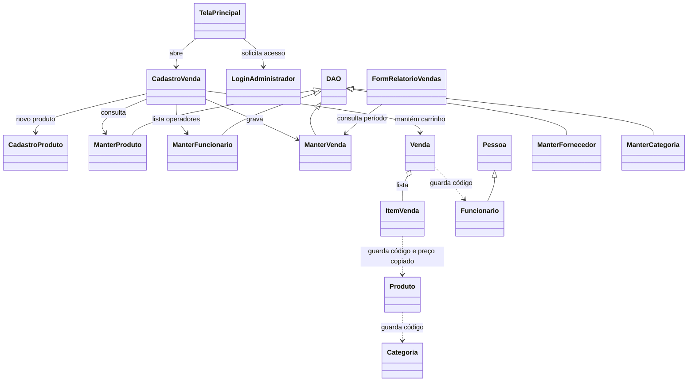
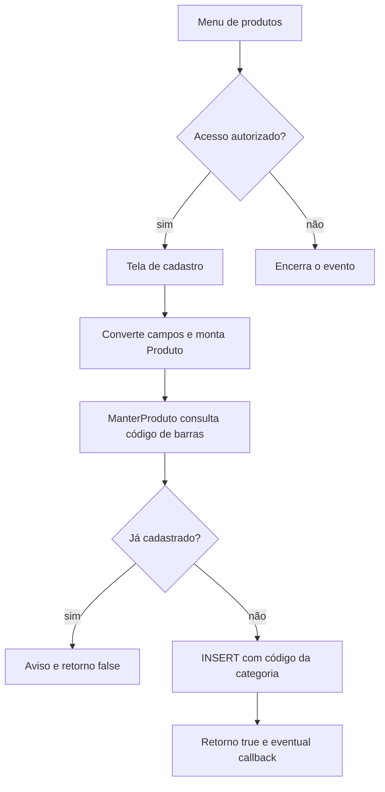
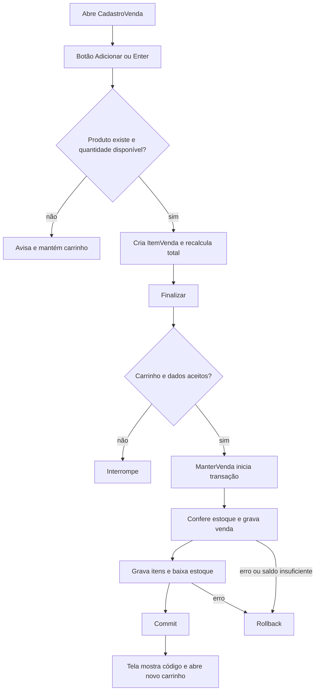
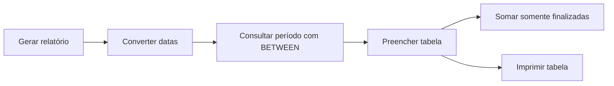

# Guia completo · Java e POO no supermercado

## 1. Arquitetura e estrutura

O aplicativo é um supermercado desktop para cadastrar dados, operar um caixa, consultar e alterar vendas e emitir um relatório por período. A operação começa em menus e formulários Swing. A tela captura texto, seleções e cliques, converte entradas e preenche modelos. As classes `ManterXxx` executam SQL por JDBC e convertem resultados do MySQL em objetos. O caixa guarda temporariamente a venda e seus itens em memória. A gravação persiste venda, itens e saldo atualizado.

```text
/
├── LEIA-ME.txt
├── build.xml
├── manifest.mf
├── database/
│   └── supermercado_trabalho.sql
├── lib/
│   └── mysql-connector-j-9.1.0.jar
├── nbproject/
│   ├── build-impl.xml
│   ├── genfiles.properties
│   ├── project.properties
│   └── project.xml
└── src/br/com/
    ├── controle/   (7 arquivos Java)
    ├── entidade/   (7 arquivos Java)
    └── visao/      (23 arquivos Java e 22 .form)
```

O inventário ao fim do guia expande os nomes dos arquivos Java. Cada janela tem um `.form` homônimo usado pelo editor visual do NetBeans. `LoginAdministrador` é auxiliar, sem formulário próprio. `build.xml` importa a configuração Ant gerada em `nbproject/build-impl.xml`. `nbproject/project.properties:36–50,76` aponta para o driver local, configura Java 17 e declara `br.com.visao.TelaPrincipal` como entrada. `manifest.mf` é o modelo do manifesto do JAR. `database/supermercado_trabalho.sql:9–70` define banco, tabelas e relacionamentos. O arquivo SQL também contém dados iniciais e começa com exclusão do banco existente.

| Package | Papel comprovado pelos arquivos |
|---|---|
| `br.com.visao` | Interface, eventos, validação de entradas, coordenação das chamadas. Importa modelos, classes de persistência e APIs de Swing, logging e utilitários. |
| `br.com.controle` | Modelos de dados e regras de total. `Venda` importa `java.util.ArrayList`. |
| `br.com.entidade` | Conexão JDBC e SQL, mapeamento de resultados, atualização de estoque. Importa modelos, APIs `java.sql`, coleções e, em alguns DAOs, `JOptionPane`. |

É uma separação de apresentação, domínio e persistência por responsabilidades. Os nomes dos pacotes são convenções do projeto. As telas chamam a persistência diretamente e os DAOs também exibem mensagens Swing. Por isso, descrever como MVC estrito excede o que o código demonstra.



A seta triangular aponta para a superclasse. O losango mostra que uma venda mantém vários itens, que são criados pela tela e entregues à venda. As setas pontilhadas representam relações por dados, especialmente códigos. Fornecedor tem cadastro próprio. A tabela de produtos possui FK de categoria e carece de FK de fornecedor. No SQL, `venda` referencia funcionário e `item_venda` referencia venda e produto.

## 2. Fluxos de execução

### Entrada e acesso

Em `src/br/com/visao/TelaPrincipal.java:476–506`, a JVM chama `main`. Ele tenta selecionar o visual Nimbus e agenda a construção e exibição na thread de eventos com `EventQueue.invokeLater`. O construtor prepara a janela. Os ouvintes em `initComponents` repassam cliques aos métodos `jMenuItemNActionPerformed`. Os itens 1–16 e 21 pedem autorização administrativa. Os itens 17–20 abrem operações de venda diretamente. `LoginAdministrador.solicitar` mostra um diálogo, repete a tentativa inválida e retorna `false` ao cancelar ou `true` ao validar. O atalho de novo produto no caixa também solicita acesso. Veja `TelaPrincipal.java:296–471`, `LoginAdministrador.java:12–42` e `CadastroVenda.java:38–45` em `visao`.

### Cadastros, consultas, alterações e exclusões

| Ação | Caminho dos dados e resultado |
|---|---|
| Cadastrar categoria, fornecedor ou funcionário | `CadastroXxx.jBcadastrarActionPerformed` lê entradas, cria o modelo com setters e chama `ManterXxx.inserir`. O DAO consulta duplicidade por nome (categoria), CNPJ (fornecedor) ou CPF (funcionário), avisa se encontrar e executa INSERT parametrizado caso contrário. Veja `entidade/ManterCategoria.java:17–34`, `entidade/ManterFornecedor.java:17–36` e `entidade/ManterFuncionario.java:17–36`. Os campos correspondem ao inventário de modelos. |
| Cadastrar produto | `CadastroProduto` carrega categorias de `ManterCategoria.PesquisarTudo`. No clique, converte preço/estoque, extrai o código da categoria, cria `Produto` e chama `ManterProduto.inserir`. O DAO consulta duplicidade por barras e devolve um booleano. Se salvar via caixa, `Consumer<Produto>` atualiza e seleciona o produto no combo. `CadastroProduto.java:20–42,149–180`, `ManterProduto.java:17–39`. |
| Consultar todos | `FormListarXxx` chama `carregarRegistros` ao abrir e na pesquisa. Com campo vazio, `ManterXxx.PesquisarTudo` percorre o `ResultSet` e retorna lista. Com código preenchido, o formulário converte a entrada e chama `PesquisarRegistro` para exibir um registro. Veja `visao/FormListarProdutos.java:108–133` e `visao/FormListarVendas.java:108–137`. A tela repopula o modelo da tabela. Produto mostra nome de categoria e vendas mostram nome de funcionário. Em erro, vários DAOs escrevem no console, podendo devolver lista vazia ou parcial. |
| Consultar por código e alterar | `FormAlterarXxx.jBpesquisarActionPerformed` passa o código em um objeto ao DAO. `PesquisarRegistro` preenche esse mesmo objeto se encontrar a linha e em geral marca código zero quando ausente. A tela usa getters para preencher entradas. `jBalterarActionPerformed` monta os dados editados e chama `editarXxx`, que usa UPDATE por código. Produto pode editar estoque diretamente. Venda permite CPF, pagamento e status, consultando também itens para exibição. |
| Excluir | `FormDeletarXxx.jBdeletarActionPerformed` converte o código e chama `deletarXxx`. O DAO executa DELETE parametrizado. FK pode bloquear exclusão de produto, categoria ou funcionário referenciado. `ManterProduto.deletarProduto` captura violação de integridade. Venda tem etapas próprias de estoque e dependências. |

Veja `src/br/com/visao` e `src/br/com/entidade`, com caminhos, métodos e linhas no inventário. Para produto, os pontos de partida são `FormAlterarProduto.java:165–219`, `FormDeletarProduto.java:82–94`, `FormListarProdutos.java:104–133` e `ManterProduto.java:17–143`.



### Caixa e relatório

O construtor de `CadastroVenda` prepara a tela, carrega produtos e operadores e oferece Dinheiro, PIX, cartão de débito e crédito. Selecionar produto preenche o código de barras. Enter no campo ou o botão Adicionar executa a mesma ação. O carrinho começa com `new Venda()`. Remover exige seleção e recalcula o total. Nova venda troca o objeto, limpa os campos pertinentes e recarrega o combo. Abrir ou adicionar itens afeta memória e consultas, enquanto a baixa é executada na transação de inserção da venda. Veja `src/br/com/visao/CadastroVenda.java:29–104,274–395`.



O fluxo de sucesso do diagrama pressupõe confirmação efetiva. O código usa o ID como indicador, com possibilidade de falso sucesso após rollback. Em edição, `FormAlterarVenda` busca cabeçalho e itens. `ManterVenda.editarVenda` lê o status antigo, devolve estoque ao cancelar e baixa ao reativar. Excluir passa por `deletarVenda`, que repõe estoque quando o status é diferente de CANCELADA, apaga itens e depois a venda. Veja `src/br/com/visao/FormAlterarVenda.java:160–214` e `src/br/com/entidade/ManterVenda.java:76–114,149–211`.



O relatório usa dia inicial e final inclusivos com `DATE(v.data_venda) BETWEEN ? AND ?`. `FormRelatorioVendas` percorre a lista, inclui canceladas na tabela e soma finalizadas. A impressão delega à tabela Swing. Datas malformadas podem gerar aviso ou erro e o filtro SQL não implementa uma validação de calendário. Veja `src/br/com/visao/FormRelatorioVendas.java:137–179` e `src/br/com/entidade/ManterVenda.java:121–146`.

Cadastro de cliente, desconto e integração com operadoras de pagamento estão ausentes. A venda aceita CPF opcional e grava o rótulo do meio de pagamento. Também não há uma entidade separada de pedido em aberto persistido.

## 3. Métodos essenciais

Os intervalos nesta seção são relativos a `src/br/com/`. Nos eventos, `private void` significa rotina interna sem valor de retorno. `ActionEvent evt` recebe o evento do Swing e os métodos abaixo leem os campos da própria janela. `public` permite chamadas por outras classes. `throws Exception` declara que a falha pode escapar, embora alguns métodos capturem exceções internamente. O inventário complementa a tabela com as demais assinaturas.

| Classe e caminho | Método | Responsabilidade | Importância |
|---|---|---|---|
| `visao/TelaPrincipal.java:476–506` | `main` | Abre a aplicação na fila gráfica | Alta |
| `visao/CadastroVenda.java:274–312` | `jBadicionarActionPerformed` | Valida, consulta e inclui item | Alta |
| `visao/CadastroVenda.java:325–368` | `jBfinalizarActionPerformed` | Captura dados, calcula troco e solicita gravação | Alta |
| `controle/Venda.java:92–108` | `adicionarItem`, `removerItem`, `calcularTotal` | Altera lista e mantém total pelo caminho normal | Alta |
| `controle/ItemVenda.java:47–49` | `getSubtotal` | Calcula valor de uma linha | Alta |
| `entidade/ManterVenda.java:24–74` | `inserir` | Persiste venda, itens e estoque em transação | Alta |
| `entidade/ManterVenda.java:76–95,170–200` | `deletarVenda`, `editarVenda` | Altera venda e movimenta saldo | Alta |
| `entidade/ManterProduto.java:109–127` | `PesquisarCodigoBarras` | Busca produto para o caixa | Alta |
| `visao/FormRelatorioVendas.java:137–161` | `jBgerarActionPerformed` | Produz tabela e total por período | Alta |
| `entidade/DAO.java:20–45` | `abrirBanco`, `fecharBanco` | Ciclo da conexão | Média |
| `entidade/ManterVenda.java:97–167,202–211` | `PesquisarRegistro`, `PesquisarTudo`, `relatorio`, `pesquisar`, `PesquisarItens`, `preencher` | Consultam e convertem linhas em objetos | Média |
| `visao/CadastroVenda.java:86–104,314–323,370–395` | `carregarProdutos`, eventos de remover/nova, `atualizarTabela` | Sincroniza os componentes com o carrinho | Média |
| `visao/LoginAdministrador.java:12–42` | `credenciaisValidas`, `solicitar` | Valida tentativa e coordena o diálogo | Média |
| `visao/FormRelatorioVendas.java:163–179` | `jBimprimirActionPerformed`, `converterData` | Imprime tabela e reorganiza data | Média |
| `entidade/ManterProduto.java:17–107,129–143` | `inserir`, `deletarProduto`, `PesquisarRegistro`, `PesquisarTudo`, `editarProduto` | CRUD de produto | Média |
| Formulários Swing | `initComponents`, ouvintes, `main` auxiliares | Montam a interface, registram eventos e abrem janelas para execução isolada | Baixa |

### Entrada e construção · TelaPrincipal.main

```java
java.awt.EventQueue.invokeLater(new Runnable() {
    public void run() {
        new TelaPrincipal().setVisible(true);
    }
});
```

- A primeira linha cria uma implementação anônima de `Runnable` e entrega a tarefa à fila de eventos.
- `run` é a operação que o Swing executará no momento de processar a tarefa.
- `new TelaPrincipal()` chama o construtor e produz uma referência. `setVisible(true)` abre a janela.
- As últimas linhas encerram a implementação e a chamada. `main` é `public static void`, recebe `String[] args` e pode ser chamado pela JVM antes de existir uma janela. O `for-each` e os `catch` anteriores ao trecho tentam preparar o Nimbus. Se falhar uma exceção de visual tratada ali, a abertura prossegue. Pergunta típica. Por que a janela é criada dentro de `run`?

### Itens e total · CadastroVenda, ManterProduto, Venda e ItemVenda

```java
int reservado = venda.getItens().stream()
        .filter(item -> item.getCodigoProduto() == p.getCodigo())
        .mapToInt(ItemVenda::getQuantidade).sum();
int disponivel = Math.max(0, p.getEstoque() - reservado);
```

- A primeira linha cria uma sequência a partir dos itens da venda.
- `filter` usa uma lambda, uma função curta que conserva só os itens com código inteiro igual ao produto atual.
- `mapToInt` extrai quantidades com referência de método. `sum` soma.
- A última linha subtrai a reserva local do saldo consultado e limita o resultado inferior a zero.

Antes desse trecho, a tela usa `trim()` no texto de barras e chama `public Produto PesquisarCodigoBarras(String codigoBarras)`. O DAO abre conexão, vincula o texto ao primeiro `?`, executa SELECT, testa `tr.next()`, instancia e preenche um produto quando encontra a linha, fecha e devolve a referência ou `null`. O método recebe um código textual, adequado para barras com zeros iniciais. A consulta tem um `if` e nenhuma repetição, e declara exceção. A tela rejeita ausência, converte quantidade, exige valor positivo e rejeita quantidade acima do disponível. Em seguida cria `ItemVenda`, copia código, nome e preço, chama `adicionarItem` e atualiza a tabela. Quantidade inválida gera diálogo, e outras exceções são registradas. Estoque 5, dois itens já reservados e pedido de 4 geram aviso de disponibilidade 3. Pergunta típica. Reservar muda o banco?

```java
public void calcularTotal() {
    total = 0;
    for (int i = 0; i < itens.size(); i++) {
        total = total + itens.get(i).getSubtotal();
    }
}
```

- A assinatura é pública, sem parâmetros e sem retorno. Modifica o atributo `total` da instância.
- Zerar evita contar novamente os valores do cálculo anterior.
- `for` começa em zero, continua enquanto o índice for menor que o tamanho e incrementa com `i++`.
- `get(i)` pega o item e `getSubtotal()` devolve `quantidade * precoUnitario` como `double`. Esse getter público é sem parâmetros e sem efeito sobre o objeto.
- O corpo encerra com o total atualizado. Dois itens de R$ 4 e um de R$ 3,50 dão R$ 11,50. O laço vazio deixa zero. Nenhum desses dois cálculos consulta o banco.

`public void adicionarItem(ItemVenda item)` recebe a referência do novo item, faz `itens.add(item)` e recalcula. `public void removerItem(int posicao)` chama `itens.remove(posicao)` pelo índice e recalcula. Nenhum dos dois valida argumentos internamente. Um índice inválido pode lançar exceção, e um item nulo pode falhar durante o cálculo. No caixa, o evento de remoção verifica se houve seleção. Pergunta típica. Por que uma alteração feita diretamente pela lista pode deixar o total desatualizado?

### Finalização · CadastroVenda e ManterVenda

O evento de finalização testa carrinho vazio, remove pontos e hífen do CPF, verifica comprimento de 11 se preenchido e guarda `null` se vazio. Lê operador e pagamento dos combos. Em dinheiro, pede o recebido, interrompe se o diálogo foi cancelado ou se o recebido for menor que o total e formata a diferença como troco. As conversões de operador e valor recebido vêm antes do `try` que engloba a gravação. Depois cria `ManterVenda`, passa a venda e, se o código estiver positivo, mostra sucesso e reseta o caixa. Pergunta típica. Qual variável a interface usa como sinal de sucesso?

```java
ResultSet chave = pst.getGeneratedKeys();
chave.next();
v.setCodigo(chave.getInt(1));// codigo gerado pelo auto_increment
```

- A primeira linha pede o resultado de chaves geradas após executar o INSERT com `RETURN_GENERATED_KEYS`.
- `next()` posiciona o cursor na primeira chave. O código pressupõe que ela existe.
- `getInt(1)` lê a primeira coluna e `setCodigo` modifica o próprio objeto que a tela enviou. As duas classes observam a mesma instância.

`public void inserir(Venda v)` recebe a venda preenchida e altera banco e código do objeto. Em 25–40, abre conexão, desliga auto-commit e percorre os itens para consultar estoque. Se o registro existe e o saldo é insuficiente, alerta, tenta rollback, fecha e sai. Em 41–51, insere cabeçalho com horário do banco e status FINALIZADA, e captura a chave. Em 53–67, outro laço insere itens vinculados e subtrai quantidades. Em 68–74, confirma com commit ou captura exceção e tenta rollback. Com estoque 10, duas unidades vendidas e commit bem-sucedido, ficam 8. Se a segunda inserção de item falha, o rollback visa desfazer todas as escritas anteriores daquela transação. O ID em memória pode continuar positivo. Pergunta típica. Por que ID gerado e commit são eventos diferentes?

### Edição, exclusão e relatório

- `public void editarVenda(Venda v)` lê status por código. Usa `.equals()` e `&&` para decidir o sinal, ajusta estoque por UPDATE com JOIN quando aplicável e grava CPF, pagamento e status. Nenhum laço Java é necessário porque o SQL opera sobre linhas. Pode lançar erro, inclusive se `tr.next()` não avançar e o resultado for lido. Exemplo. De estoque 8 para 10 ao cancelar uma venda de duas unidades. Pergunta. Onde a reativação verifica disponibilidade?
- `public void deletarVenda(Venda v)` recebe o código no objeto, repõe o estoque de vendas cujo status difere de CANCELADA, exclui dependências e exclui cabeçalho. Não há laço nem transação explícita agrupando as etapas. Exemplo. Excluir a mesma venda depois de cancelada preserva a reposição já feita. Pergunta. Por que apagar os itens antes da venda?
- `private void jBgerarActionPerformed(ActionEvent evt)` chama `converterData` para cada campo, consulta `relatorio(String dataInicio, String dataFim)` e atualiza tabela e total. `relatorio` devolve `ArrayList<Venda>` por meio de `pesquisar`. Este vincula parâmetros se a primeira data vier preenchida, lê linhas num `while (tr.next())` e usa `preencher` em cada objeto. O evento soma com `if` e captura erro de índices das partes da data e outras exceções. No mesmo período, finalizada de R$ 20 e cancelada de R$ 12 aparecem em duas linhas e somam R$ 20. Pergunta. Onde o status influencia o total?

## 4. POO, sintaxe e glossário para a defesa

Cada linha liga o conceito ao benefício prático, à leitura do código e a uma pergunta de aprofundamento. Use o trecho indicado para montar uma fala de 20–30 segundos com definição, exemplo e consequência. Caminhos relativos a `src/br/com/`.

| Conceito | Significado, uso e exemplo real | Fala de defesa e repregunta |
|---|---|---|
| Classe, objeto, instância | Classe declara estrutura e comportamento. Objeto é uma ocorrência em execução, também chamada instância de uma classe. `Venda` declara lista e total. Cada `new Venda()` inicializa sua própria lista. `controle/Venda.java:12–20,86`. | “A classe é a definição da venda. Cada carrinho é uma instância com seu próprio total.” Duas instâncias compartilham itens automaticamente? |
| Instanciação, `new`, construtor | `new` aloca e inicializa um objeto, chamando construtor. Construtor tem nome da classe e carece de tipo de retorno. `new CadastroVenda()` abre o caminho para `CadastroVenda()`, que inicializa componentes e carrega dados. `visao/TelaPrincipal.java:440–444`, `visao/CadastroVenda.java:29–77`. | “O construtor prepara a tela no momento em que crio uma instância.” O que acontece se não houver construtor declarado? |
| Atributo e variável local | Atributo representa estado do objeto, como `total`. Uma variável local existe dentro de um bloco de execução, como `i` no cálculo. `controle/Venda.java:20,103–108`. | “Total fica guardado na venda. O índice serve só para percorrer a lista.” O que ocorre se remover a reinicialização do total? |
| Método, parâmetro, argumento | Método é uma operação nomeada. Parâmetro é a variável declarada na assinatura. Argumento é a expressão passada no momento da chamada. `Venda.adicionarItem(ItemVenda item)` recebe o argumento `item` da janela, em `visao/CadastroVenda.java:296–302` e `controle/Venda.java:92–95`. | “A tela passa o item que construiu. A venda recebe a referência no parâmetro e adiciona à lista.” Os nomes precisam coincidir? |
| Referência e `null` | A variável guarda uma referência ao objeto. Java copia o valor dessa referência quando chama método. `null` indica ausência de referência a objeto. `ManterProduto.PesquisarCodigoBarras` pode devolver `null`, tratado pela tela. `entidade/ManterProduto.java:109–127`, `visao/CadastroVenda.java:277–282,359–363`. | “DAO e tela podem alcançar a mesma venda. Mudar seu código é observável nas duas.” Reatribuir `v` dentro do DAO trocaria a variável da tela? |
| `this` e `this()` | `this.codigo = codigo` identifica o atributo do objeto atual quando parâmetro tem o mesmo nome. `this()` chama outro construtor da mesma classe. `controle/Venda.java:26–28`, `visao/CadastroProduto.java:25–42`. | “Com `this` eu qualifico o campo, e com parênteses eu encadeio a inicialização.” Poderia mover `this()` para depois da atribuição em Java 17? |
| `public`, `private`, padrão, `protected` | Público expõe operações. Privado restringe o acesso ao contexto da classe. Sem modificador o acesso é do pacote, como os campos de `DAO`. `protected` daria acesso ao pacote e acesso herdado sob as regras de subclasses externas ao pacote, mas não há declaração explícita no projeto. `entidade/DAO.java:15–20`, `controle/Produto.java:9–23`. | “O DAO e seus filhos estão juntos, então os campos com acesso de pacote são acessíveis a eles.” Uma classe de outro pacote acessaria `con` diretamente? |
| Getters, setters e encapsulamento | Getters observam, setters alteram. Encapsular também é controlar invariantes. `Produto` tem campos privados, mas os setters só atribuem. `Venda.getItens()` devolve a lista mutável e abre caminho para alterar sem recalcular. `controle/Produto.java:41–55`, `controle/Venda.java:82–108`. | “A visibilidade organiza acesso. A regra do total depende do caminho usado para modificar a lista.” Um getter pode enfraquecer encapsulamento? |
| `extends`, `super` e abstrata | Herança expressa relação de subtipo e reutiliza comportamento. `Pessoa` abstrata define campos e contrato `getTipo`, `Funcionario extends Pessoa` fornece o método. `super` permite chamar membro ou construtor da superclasse. Chamadas explícitas com `super` não aparecem, e os construtores normais dependem do encadeamento implícito. `controle/Pessoa.java:8–48`, `controle/Funcionario.java:7–23`. | “Funcionário pode usar os métodos herdados de pessoa e completar a operação abstrata.” Por que `new Pessoa()` é inválido? |
| Sobrescrita, `@Override`, polimorfismo | Sobrescrita fornece a implementação de uma operação herdada. A anotação faz o compilador verificar a intenção. A chamada de instância é resolvida pela implementação do objeto concreto. O domínio declara o contrato em `Pessoa`, e o fluxo usa `Funcionario` diretamente. Swing chama callbacks por contratos como `Runnable` e `ActionListener`. `controle/Funcionario.java:19–22`, `visao/TelaPrincipal.java:76–81,501–505`. | “A hierarquia permite despachar `getTipo` pela instância concreta. Nos eventos, o Swing chama a implementação que o formulário registrou.” `getTipo` é chamado no fluxo do caixa? |
| Sobrecarga | Mesmo nome com assinaturas de parâmetros diferentes, escolha em compilação. `CadastroProduto()` e `CadastroProduto(Consumer<Produto>)` permitem uso pelo menu e com callback. Retorno diferente, sozinho, não cria sobrecarga. `visao/CadastroProduto.java:25–42`. | “Posso abrir a mesma tela de duas maneiras, com ou sem aviso a quem chamou.” Qual delas roda primeiro no construtor com callback? |
| Interface e `implements` | Interface descreve um contrato. `implements` aparece na sintaxe de classes nomeadas que adotam interface, mas nenhuma declaração explícita com essa palavra foi encontrada. O código usa interfaces via JDBC, lambdas e classes anônimas, como `Connection`, `Consumer<Produto>` e `new Runnable() {...}`. `entidade/DAO.java:7–18`, `visao/CadastroProduto.java:20,39–42`, `visao/TelaPrincipal.java:501–505`. | “A tela só precisa saber chamar `accept` no consumidor para notificar o caixa.” Quem fornece o comportamento do consumidor? |
| Associação, agregação e composição | Associação liga entidades. Código de categoria associa produto a categoria. Agregação é relação todo-parte com partes criadas externamente, como o item entregue à venda. Composição sugere propriedade e ciclo de vida controlado pelo todo. No banco, itens dependem da venda por FK e exclusão ordenada. `controle/Produto.java:14`, `controle/Venda.java:86–95`, `entidade/ManterVenda.java:76–95`. | “O modelo guarda os itens e o banco liga cada linha ao cabeçalho.” Existe uma referência direta de `Produto` em `ItemVenda`? |
| `static` e método de instância | Estático é chamado pela classe. Método de instância pode acessar seu estado e usa um receptor. `TelaPrincipal.main` é estático. `Venda.calcularTotal` precisa da lista de uma venda concreta. `visao/TelaPrincipal.java:476`, `controle/Venda.java:103–108`. | “O ponto de entrada existe antes da janela. Calcular total depende do carrinho que recebeu a chamada.” `main` pode usar `this` diretamente? |
| `final` | Em classe impede subclasses, como `LoginAdministrador`. Em variável impede reatribuição e em método impede sobrescrita. Uma referência final pode apontar a objeto mutável. `visao/LoginAdministrador.java:9–10`. | “Esse auxiliar é final e tem construtor privado. O código chama suas rotinas estáticas.” Tornar a lista final impediria `add`? |
| `void`, retorno e `return` | `void` indica ausência de valor. `return;` encerra cedo. Um tipo de retorno como `double` exige devolver valor compatível nos caminhos normais. `controle/ItemVenda.java:47–49`, `visao/CadastroVenda.java:279–286`. | “Subtotal devolve um número. Adicionar pode sair cedo ao detectar erro.” `void` impede alterar o estado? |
| Tipos | `int` representa códigos e quantidade. `double` é ponto flutuante. `boolean` representa sim/não, por exemplo no cadastro de produto. `String` é classe para texto, inclusive códigos de barras. Também aparecem `float` no tamanho de fonte, `char[]` para senha e arrays `String[]` e `Object[]`. `controle/Produto.java:9–15`, `entidade/ManterProduto.java:17–38`, `visao/CadastroVenda.java:58`, `visao/LoginAdministrador.java:12–36`. | “Preço vira double e a coluna no banco é decimal de duas casas.” Por que manter barras como texto? |
| `==` e `.equals()` | Para os inteiros no filtro, `==` compara valores. Para referências compara identidade, inclusive o teste com `null`. `String.equals` compara conteúdo. `visao/CadastroVenda.java:279,289,345`. | “Uso igualdade de valor nos códigos inteiros e conteúdo nos rótulos.” O que acontece ao chamar `.equals` em referência nula? |
| `ArrayList`, `List`, `Map` e genéricos | `ArrayList<ItemVenda>` é lista redimensionável e indexada, com tipo de elemento indicado entre ângulos. `List` é a interface implementada por `ArrayList`, sem uso como tipo declarado no fonte. `Map` associa chave a valor e está ausente. Modelos de combo e tabela mantêm opções e células. `controle/Venda.java:86–108`, `visao/CadastroVenda.java:86–97,385–395`. | “O tipo do elemento ajuda o compilador. Uso índice para remover a linha selecionada.” O que `getItens` devolve? |
| `if`, `else`, `switch` | Decidem por condições. `if/else` escolhe CPF nulo ou preenchido. `switch` seleciona por casos e está ausente. `visao/CadastroVenda.java:331–340`. | “Conforme o valor do campo, o objeto guarda texto ou null.” A condição testa os dígitos? |
| `for`, `while`, `for-each` | `for` indexa a lista, `while` repete enquanto o cursor avança, `for-each` percorre elementos diretamente. `controle/Venda.java:105`, `entidade/ManterVenda.java:136`, `visao/CadastroVenda.java:90`. | “No banco, cada `next()` tenta avançar para mais uma linha.” O que acontece quando a lista está vazia? |
| Exceção, `try`, `catch`, `finally`, `throws` | Exceção interrompe o caminho normal. `try` delimita código protegido, `catch` reage a um tipo e `throws` anuncia exceções que podem escapar. `finally` executaria limpeza na saída normal ou excepcional e está ausente. `visao/CadastroVenda.java:274–312`, `entidade/ManterVenda.java:24–74`. | “Entrada inválida pode cair no catch específico, e falha na gravação pode provocar rollback.” Quais conversões estão fora do try da finalização? |
| Package e import | Package agrupa classes e participa da visibilidade. Import permite usar o nome simples de outro pacote. `visao/CadastroVenda.java:5–18` importa modelos, DAOs, coleção, logging e Swing. | “Posso escrever `Venda` após importar seu nome completo.” Import carrega os dados do banco? |
| JDBC, SQL, FK e transação | JDBC conecta Java ao banco. `PreparedStatement` separa comando e valores. FK protege relação entre tabelas. Uma transação reúne escritas para confirmar ou desfazer. `entidade/ManterVenda.java:24–74`, `database/supermercado_trabalho.sql:39–70`. | “O código gerado identifica a venda para os itens, e commit confirma as mudanças.” Por que a transação sozinha não resolve concorrência de estoque? |

## 5. Inventário das classes

Foram localizados 37 tipos de topo e um record nomeado aninhado. O inventário registra 293 declarações explícitas de métodos, incluindo 82 métodos de classes anônimas (52 ouvintes, 22 tarefas Runnable e 8 modelos de tabela). A contagem exclui construtores, métodos gerados pelo compilador, métodos de bibliotecas e lambdas.

Os modelos e DAOs sem construtor declarado recebem construtor padrão. `Pessoa` também possui inicialização implícita, acessível na construção de sua subclasse. As classes de janela concretas herdam de `JFrame`, têm construtores públicos e são instanciadas pela tela principal e pelos seus próprios `main` auxiliares, quando presentes. Remover uma janela quebra a chamada que a abre. Remover um modelo quebra as telas ou DAOs que o declaram. Remover um `ManterXxx` interrompe a persistência ou consultas daquele módulo e os consumidores listados. Abaixo estão os atributos, construtores, métodos e imports por arquivo. Declarações de ouvintes e modelos anônimos são registradas no arquivo que as contém.

| Classe | Responsabilidade, usuários e impacto da remoção |
|---|---|
| Categoria | Modelo criado em formulários e em `ManterCategoria`; alimenta o combo de produto. Sua remoção quebra também seleção de categorias. |
| Fornecedor | Modelo criado pelas telas de fornecedores e pelo DAO em consultas; sua remoção quebra o CRUD correspondente. |
| Pessoa | Superclasse abstrata com dados comuns e contrato `getTipo`; sua remoção quebra `Funcionario`. |
| Funcionario | Criado por formulários e `ManterFuncionario`; fornece dados para cadastro e seleção do operador em `CadastroVenda`. |
| Produto | Criado em formulários e consultas de `ManterProduto`; fornece código, preço e estoque ao caixa. |
| ItemVenda | Criado na inclusão pelo caixa e na consulta de itens pelo DAO; participa do total e da tabela de detalhes. |
| Venda | Criada pelo caixa, formulários de alteração/exclusão e consultas em `ManterVenda`; centraliza o carrinho. |
| DAO | Superclasse concreta, reutilizada pelos cinco `ManterXxx` e instanciada por `TestCon`; sua remoção rompe a infraestrutura JDBC. |
| ManterCategoria | Persiste e consulta categorias; também usado por cadastro e alteração de produto. |
| ManterFornecedor | Persiste e consulta fornecedores; consumido pelas quatro telas desse módulo. |
| ManterFuncionario | Persiste e consulta funcionários; atende CRUD e combo de operadores do caixa. |
| ManterProduto | Persiste e consulta produtos; atende CRUD e busca de barras no caixa. |
| ManterVenda | Persiste, movimenta estoque, consulta cabeçalho/itens e fornece o relatório. |
| TestCon | Entrada auxiliar de teste de conexão. Sua retirada elimina essa verificação independente. |
| TelaPrincipal | Constrói o menu e abre as janelas. Sua retirada elimina a entrada configurada. |
| LoginAdministrador | Utilitário final com acesso de pacote e construtor privado. Chamadas estáticas verificam acesso nos menus protegidos e no atalho do caixa. |
| CadastroCategoria | Captura categoria e aciona inserção em `ManterCategoria`. |
| CadastroFornecedor | Captura fornecedor e aciona inserção em `ManterFornecedor`. |
| CadastroFuncionario | Captura funcionário e aciona inserção em `ManterFuncionario`. |
| CadastroProduto | Carrega categorias e cadastra produto. Pode ser aberto pelo menu ou caixa, com callback opcional. |
| CadastroVenda | Mantém `Venda`, consulta produtos/funcionários, monta itens e finaliza. |
| CadastroVenda.OpcaoProduto | Record privado com componente `Produto produto`, criado por `carregarProdutos`. Acessor `produto()` e construtor canônico são gerados. `toString` define o rótulo mostrado, inclusive o placeholder. A remoção quebra o modelo do combo. |
| FormAlterarCategoria | Busca por código, preenche campos e envia edição de categoria. |
| FormAlterarFornecedor | Busca por código, preenche campos e envia edição de fornecedor. |
| FormAlterarFuncionario | Busca por código, preenche campos e envia edição de funcionário. |
| FormAlterarProduto | Busca por código, seleciona categoria do registro e envia edição. |
| FormAlterarVenda | Busca cabeçalho e itens, edita CPF, pagamento e status. |
| FormDeletarCategoria | Lê código e solicita exclusão de categoria. |
| FormDeletarFornecedor | Lê código e solicita exclusão de fornecedor. |
| FormDeletarFuncionario | Lê código e solicita exclusão de funcionário. |
| FormDeletarProduto | Lê código e solicita exclusão de produto. |
| FormDeletarVenda | Lê código e solicita exclusão de venda com reposição conforme status. |
| FormListarCategorias | Mostra lista de categorias retornada pelo DAO. |
| FormListarFornecedores | Mostra lista de fornecedores retornada pelo DAO. |
| FormListarFuncionarios | Mostra lista de funcionários retornada pelo DAO. |
| FormListarProdutos | Mostra produtos, incluindo o nome da categoria. |
| FormListarVendas | Mostra vendas, incluindo nome do operador e status. |
| FormRelatorioVendas | Recebe período, consulta `ManterVenda`, totaliza finalizadas e imprime a tabela. |


### Categoria

Arquivo: `src/br/com/controle/Categoria.java`.

- L5 · `package br.com.controle`
- L7 · `public class Categoria`
- L8 · campo `private int codigo`
- L9 · campo `private String nome`
- L10 · campo `private String descricao`
- L12 · `public int getCodigo()`
- L16 · `public void setCodigo(int codigo)`
- L20 · `public String getNome()`
- L24 · `public void setNome(String nome)`
- L28 · `public String getDescricao()`
- L32 · `public void setDescricao(String descricao)`

### Fornecedor

Arquivo: `src/br/com/controle/Fornecedor.java`.

- L5 · `package br.com.controle`
- L7 · `public class Fornecedor`
- L8 · campo `private int codigo`
- L9 · campo `private String razaoSocial`
- L10 · campo `private String cnpj`
- L11 · campo `private String telefone`
- L12 · campo `private String email`
- L14 · `public int getCodigo()`
- L18 · `public void setCodigo(int codigo)`
- L22 · `public String getRazaoSocial()`
- L26 · `public void setRazaoSocial(String razaoSocial)`
- L30 · `public String getCnpj()`
- L34 · `public void setCnpj(String cnpj)`
- L38 · `public String getTelefone()`
- L42 · `public void setTelefone(String telefone)`
- L46 · `public String getEmail()`
- L50 · `public void setEmail(String email)`

### Funcionario

Arquivo: `src/br/com/controle/Funcionario.java`.

- L5 · `package br.com.controle`
- L8 · `public class Funcionario extends Pessoa`
- L9 · campo `private String cargo`
- L11 · `public String getCargo()`
- L15 · `public void setCargo(String cargo)`
- L20 · `public String getTipo()`

### ItemVenda

Arquivo: `src/br/com/controle/ItemVenda.java`.

- L5 · `package br.com.controle`
- L8 · `public class ItemVenda`
- L9 · campo `private int codigoProduto`
- L10 · campo `private String nomeProduto`
- L11 · campo `private int quantidade`
- L12 · campo `private double precoUnitario`
- L14 · `public int getCodigoProduto()`
- L18 · `public void setCodigoProduto(int codigoProduto)`
- L22 · `public String getNomeProduto()`
- L26 · `public void setNomeProduto(String nomeProduto)`
- L30 · `public int getQuantidade()`
- L34 · `public void setQuantidade(int quantidade)`
- L38 · `public double getPrecoUnitario()`
- L42 · `public void setPrecoUnitario(double precoUnitario)`
- L47 · `public double getSubtotal()`

### Pessoa

Arquivo: `src/br/com/controle/Pessoa.java`.

- L5 · `package br.com.controle`
- L9 · `public abstract class Pessoa`
- L10 · campo `private int codigo`
- L11 · campo `private String nome`
- L12 · campo `private String cpf`
- L13 · campo `private String telefone`
- L15 · `public int getCodigo()`
- L19 · `public void setCodigo(int codigo)`
- L23 · `public String getNome()`
- L27 · `public void setNome(String nome)`
- L31 · `public String getCpf()`
- L35 · `public void setCpf(String cpf)`
- L39 · `public String getTelefone()`
- L43 · `public void setTelefone(String telefone)`
- L48 · `public abstract String getTipo()`

### Produto

Arquivo: `src/br/com/controle/Produto.java`.

- L5 · `package br.com.controle`
- L8 · `public class Produto`
- L9 · campo `private int codigo`
- L10 · campo `private String nome`
- L11 · campo `private String codigoBarras`
- L12 · campo `private double preco`
- L13 · campo `private int estoque`
- L14 · campo `private int codigoCategoria`
- L15 · campo `private String nomeCategoria`
- L17 · `public int getCodigo()`
- L21 · `public void setCodigo(int codigo)`
- L25 · `public String getNome()`
- L29 · `public void setNome(String nome)`
- L33 · `public String getCodigoBarras()`
- L37 · `public void setCodigoBarras(String codigoBarras)`
- L41 · `public double getPreco()`
- L45 · `public void setPreco(double preco)`
- L49 · `public int getEstoque()`
- L53 · `public void setEstoque(int estoque)`
- L57 · `public int getCodigoCategoria()`
- L61 · `public void setCodigoCategoria(int codigoCategoria)`
- L65 · `public String getNomeCategoria()`
- L69 · `public void setNomeCategoria(String nomeCategoria)`

### Venda

Arquivo: `src/br/com/controle/Venda.java`.

- L5 · `package br.com.controle`
- L7 · `import java.util.ArrayList`
- L12 · `public class Venda`
- L13 · campo `private int codigo`
- L14 · campo `private String cpfCliente`
- L15 · campo `private int codigoFuncionario`
- L16 · campo `private String nomeFuncionario`
- L17 · campo `private String dataVenda`
- L18 · campo `private String formaPagamento`
- L19 · campo `private String status`
- L20 · campo `private double total`
- L22 · `public int getCodigo()`
- L26 · `public void setCodigo(int codigo)`
- L30 · `public String getCpfCliente()`
- L34 · `public void setCpfCliente(String cpfCliente)`
- L38 · `public int getCodigoFuncionario()`
- L42 · `public void setCodigoFuncionario(int codigoFuncionario)`
- L46 · `public String getNomeFuncionario()`
- L50 · `public void setNomeFuncionario(String nomeFuncionario)`
- L54 · `public String getDataVenda()`
- L58 · `public void setDataVenda(String dataVenda)`
- L62 · `public String getFormaPagamento()`
- L66 · `public void setFormaPagamento(String formaPagamento)`
- L70 · `public String getStatus()`
- L74 · `public void setStatus(String status)`
- L78 · `public double getTotal()`
- L82 · `public void setTotal(double total)`
- L86 · campo `private ArrayList<ItemVenda> itens`
- L88 · `public ArrayList<ItemVenda> getItens()`
- L92 · `public void adicionarItem(ItemVenda item)`
- L97 · `public void removerItem(int posicao)`
- L103 · `public void calcularTotal()`

### DAO

Arquivo: `src/br/com/entidade/DAO.java`.

- L5 · `package br.com.entidade`
- L7 · `import java.sql.Connection`
- L8 · `import java.sql.DriverManager`
- L9 · `import java.sql.PreparedStatement`
- L10 · `import java.sql.ResultSet`
- L11 · `import java.sql.SQLException`
- L12 · `import java.util.logging.Level`
- L13 · `import java.util.logging.Logger`
- L15 · `public class DAO`
- L16 · campo `Connection con`
- L17 · campo `PreparedStatement pst`
- L18 · campo `ResultSet rs`
- L20 · `public void abrirBanco() throws SQLException`
- L37 · `public void fecharBanco() throws Exception`

### ManterCategoria

Arquivo: `src/br/com/entidade/ManterCategoria.java`.

- L5 · `package br.com.entidade`
- L7 · `import br.com.controle.Categoria`
- L8 · `import java.sql.PreparedStatement`
- L10 · `import javax.swing.JOptionPane`
- L11 · `import java.sql.ResultSet`
- L12 · `import java.util.ArrayList`
- L15 · `public class ManterCategoria extends DAO`
- L17 · `public void inserir(Categoria c) throws Exception`
- L36 · `public void deletarCategoria(Categoria c) throws Exception`
- L51 · `public void PesquisarRegistro(Categoria c) throws Exception`
- L71 · `public ArrayList<Categoria> PesquisarTudo() throws Exception`
- L94 · `public void editarCategoria(Categoria c) throws Exception`

### ManterFornecedor

Arquivo: `src/br/com/entidade/ManterFornecedor.java`.

- L5 · `package br.com.entidade`
- L7 · `import br.com.controle.Fornecedor`
- L8 · `import java.sql.PreparedStatement`
- L10 · `import javax.swing.JOptionPane`
- L11 · `import java.sql.ResultSet`
- L12 · `import java.util.ArrayList`
- L15 · `public class ManterFornecedor extends DAO`
- L17 · `public void inserir(Fornecedor f) throws Exception`
- L38 · `public void deletarFornecedor(Fornecedor f) throws Exception`
- L53 · `public void PesquisarRegistro(Fornecedor f) throws Exception`
- L75 · `public ArrayList<Fornecedor> PesquisarTudo() throws Exception`
- L100 · `public void editarFornecedor(Fornecedor f) throws Exception`

### ManterFuncionario

Arquivo: `src/br/com/entidade/ManterFuncionario.java`.

- L5 · `package br.com.entidade`
- L7 · `import br.com.controle.Funcionario`
- L8 · `import java.sql.PreparedStatement`
- L10 · `import javax.swing.JOptionPane`
- L11 · `import java.sql.ResultSet`
- L12 · `import java.util.ArrayList`
- L15 · `public class ManterFuncionario extends DAO`
- L17 · `public void inserir(Funcionario f) throws Exception`
- L38 · `public void deletarFuncionario(Funcionario f) throws Exception`
- L53 · `public void PesquisarRegistro(Funcionario f) throws Exception`
- L75 · `public ArrayList<Funcionario> PesquisarTudo() throws Exception`
- L100 · `public void editarFuncionario(Funcionario f) throws Exception`

### ManterProduto

Arquivo: `src/br/com/entidade/ManterProduto.java`.

- L5 · `package br.com.entidade`
- L7 · `import br.com.controle.Produto`
- L8 · `import java.sql.PreparedStatement`
- L10 · `import javax.swing.JOptionPane`
- L11 · `import java.sql.ResultSet`
- L12 · `import java.util.ArrayList`
- L15 · `public class ManterProduto extends DAO`
- L17 · `public boolean inserir(Produto p) throws Exception`
- L41 · `public void deletarProduto(Produto p) throws Exception`
- L56 · `public void PesquisarRegistro(Produto p) throws Exception`
- L81 · `public ArrayList<Produto> PesquisarTudo() throws Exception`
- L109 · `public Produto PesquisarCodigoBarras(String codigoBarras) throws Exception`
- L129 · `public void editarProduto(Produto p) throws Exception`

### ManterVenda

Arquivo: `src/br/com/entidade/ManterVenda.java`.

- L5 · `package br.com.entidade`
- L7 · `import br.com.controle.ItemVenda`
- L8 · `import br.com.controle.Venda`
- L9 · `import java.sql.PreparedStatement`
- L10 · `import java.sql.Statement`
- L12 · `import javax.swing.JOptionPane`
- L13 · `import java.sql.ResultSet`
- L14 · `import java.util.ArrayList`
- L17 · `public class ManterVenda extends DAO`
- L20 · campo `private String selectJoin`
- L24 · `public void inserir(Venda v) throws Exception`
- L76 · `public void deletarVenda(Venda v) throws Exception`
- L97 · `public void PesquisarRegistro(Venda v) throws Exception`
- L116 · `public ArrayList<Venda> PesquisarTudo() throws Exception`
- L121 · `public ArrayList<Venda> relatorio(String dataInicio, String dataFim) throws Exception`
- L125 · `private ArrayList<Venda> pesquisar(String query, String data1, String data2) throws Exception`
- L149 · `public ArrayList<ItemVenda> PesquisarItens(int codigoVenda) throws Exception`
- L170 · `public void editarVenda(Venda v) throws Exception`
- L202 · `private void preencher(Venda v, ResultSet tr) throws Exception`

### TestCon

Arquivo: `src/br/com/entidade/TestCon.java`.

- L5 · `package br.com.entidade`
- L7 · `import java.sql.SQLException`
- L9 · `public class TestCon extends DAO`
- L10 · `public static void main(String[] args) throws SQLException`

### CadastroCategoria

Arquivo: `src/br/com/visao/CadastroCategoria.java`.

- L5 · `package br.com.visao`
- L7 · `import br.com.controle.Categoria`
- L8 · `import br.com.entidade.ManterCategoria`
- L9 · `import java.util.logging.Level`
- L10 · `import java.util.logging.Logger`
- L16 · `public class CadastroCategoria extends javax.swing.JFrame`
- L21 · construtor `public CadastroCategoria()`
- L32 · `private void initComponents()`
- L49 · `public void actionPerformed(java.awt.event.ActionEvent evt)`
- L94 · `private void jBcadastrarActionPerformed(java.awt.event.ActionEvent evt)`
- L113 · `public static void main(String args[])`
- L139 · `public void run()`
- L146 · campo `private javax.swing.JButton jBcadastrar`
- L147 · campo `private javax.swing.JLabel jLabel1`
- L148 · campo `private javax.swing.JLabel jLabel2`
- L149 · campo `private javax.swing.JTextField jTdescricao`
- L150 · campo `private javax.swing.JTextField jTnome`

### CadastroFornecedor

Arquivo: `src/br/com/visao/CadastroFornecedor.java`.

- L5 · `package br.com.visao`
- L7 · `import br.com.controle.Fornecedor`
- L8 · `import br.com.entidade.ManterFornecedor`
- L9 · `import java.util.logging.Level`
- L10 · `import java.util.logging.Logger`
- L16 · `public class CadastroFornecedor extends javax.swing.JFrame`
- L21 · construtor `public CadastroFornecedor()`
- L32 · `private void initComponents()`
- L57 · `public void actionPerformed(java.awt.event.ActionEvent evt)`
- L118 · `private void jBcadastrarActionPerformed(java.awt.event.ActionEvent evt)`
- L141 · `public static void main(String args[])`
- L167 · `public void run()`
- L174 · campo `private javax.swing.JButton jBcadastrar`
- L175 · campo `private javax.swing.JLabel jLabel1`
- L176 · campo `private javax.swing.JLabel jLabel2`
- L177 · campo `private javax.swing.JLabel jLabel3`
- L178 · campo `private javax.swing.JLabel jLabel4`
- L179 · campo `private javax.swing.JTextField jTcnpj`
- L180 · campo `private javax.swing.JTextField jTemail`
- L181 · campo `private javax.swing.JTextField jTrazao`
- L182 · campo `private javax.swing.JTextField jTtelefone`

### CadastroFuncionario

Arquivo: `src/br/com/visao/CadastroFuncionario.java`.

- L5 · `package br.com.visao`
- L7 · `import br.com.controle.Funcionario`
- L8 · `import br.com.entidade.ManterFuncionario`
- L9 · `import java.util.logging.Level`
- L10 · `import java.util.logging.Logger`
- L16 · `public class CadastroFuncionario extends javax.swing.JFrame`
- L21 · construtor `public CadastroFuncionario()`
- L32 · `private void initComponents()`
- L57 · `public void actionPerformed(java.awt.event.ActionEvent evt)`
- L118 · `private void jBcadastrarActionPerformed(java.awt.event.ActionEvent evt)`
- L141 · `public static void main(String args[])`
- L167 · `public void run()`
- L174 · campo `private javax.swing.JButton jBcadastrar`
- L175 · campo `private javax.swing.JLabel jLabel1`
- L176 · campo `private javax.swing.JLabel jLabel2`
- L177 · campo `private javax.swing.JLabel jLabel3`
- L178 · campo `private javax.swing.JLabel jLabel4`
- L179 · campo `private javax.swing.JTextField jTcargo`
- L180 · campo `private javax.swing.JTextField jTcpf`
- L181 · campo `private javax.swing.JTextField jTnome`
- L182 · campo `private javax.swing.JTextField jTtelefone`

### CadastroProduto

Arquivo: `src/br/com/visao/CadastroProduto.java`.

- L5 · `package br.com.visao`
- L7 · `import br.com.controle.Produto`
- L8 · `import br.com.entidade.ManterProduto`
- L9 · `import java.util.logging.Level`
- L10 · `import java.util.logging.Logger`
- L11 · `import br.com.controle.Categoria`
- L12 · `import br.com.entidade.ManterCategoria`
- L13 · `import java.util.ArrayList`
- L19 · `public class CadastroProduto extends javax.swing.JFrame`
- L20 · campo `private java.util.function.Consumer<Produto> aoCadastrar`
- L25 · construtor `public CadastroProduto()`
- L39 · construtor com acesso de pacote `CadastroProduto(java.util.function.Consumer<Produto> aoCadastrar)`
- L51 · `private void initComponents()`
- L80 · `public void actionPerformed(java.awt.event.ActionEvent evt)`
- L149 · `private void jBcadastrarActionPerformed(java.awt.event.ActionEvent evt)`
- L185 · `public static void main(String args[])`
- L211 · `public void run()`
- L218 · campo `private javax.swing.JButton jBcadastrar`
- L219 · campo `private javax.swing.JComboBox<String> jCcategoria`
- L220 · campo `private javax.swing.JLabel jLabel1`
- L221 · campo `private javax.swing.JLabel jLabel2`
- L222 · campo `private javax.swing.JLabel jLabel3`
- L223 · campo `private javax.swing.JLabel jLabel4`
- L224 · campo `private javax.swing.JLabel jLabel5`
- L225 · campo `private javax.swing.JTextField jTcodigoBarras`
- L226 · campo `private javax.swing.JTextField jTestoque`
- L227 · campo `private javax.swing.JTextField jTnome`
- L228 · campo `private javax.swing.JTextField jTpreco`

### CadastroVenda

Arquivo: `src/br/com/visao/CadastroVenda.java`.

- L5 · `package br.com.visao`
- L7 · `import br.com.controle.Funcionario`
- L8 · `import br.com.controle.ItemVenda`
- L9 · `import br.com.controle.Produto`
- L10 · `import br.com.controle.Venda`
- L11 · `import br.com.entidade.ManterFuncionario`
- L12 · `import br.com.entidade.ManterProduto`
- L13 · `import br.com.entidade.ManterVenda`
- L14 · `import java.util.ArrayList`
- L15 · `import java.util.logging.Level`
- L16 · `import java.util.logging.Logger`
- L17 · `import javax.swing.JOptionPane`
- L18 · `import javax.swing.table.DefaultTableModel`
- L24 · `public class CadastroVenda extends javax.swing.JFrame`
- L29 · construtor `public CadastroVenda()`
- L50 · `public void actionPerformed(java.awt.event.ActionEvent evt)`
- L79 · `private record OpcaoProduto(Produto produto)`
- L81 · `public String toString()`
- L86 · `private void carregarProdutos(String codigoBarras)`
- L113 · `private void initComponents()`
- L152 · `public void actionPerformed(java.awt.event.ActionEvent evt)`
- L159 · `public void actionPerformed(java.awt.event.ActionEvent evt)`
- L170 · `public void actionPerformed(java.awt.event.ActionEvent evt)`
- L177 · `public void actionPerformed(java.awt.event.ActionEvent evt)`
- L194 · `public boolean isCellEditable(int rowIndex, int columnIndex)`
- L274 · `private void jBadicionarActionPerformed(java.awt.event.ActionEvent evt)`
- L314 · `private void jBremoverActionPerformed(java.awt.event.ActionEvent evt)`
- L325 · `private void jBfinalizarActionPerformed(java.awt.event.ActionEvent evt)`
- L370 · `private void jBnovaActionPerformed(java.awt.event.ActionEvent evt)`
- L382 · campo `private Venda venda`
- L385 · `private void atualizarTabela()`
- L399 · `public static void main(String args[])`
- L425 · `public void run()`
- L432 · campo `private javax.swing.JButton jBadicionar`
- L433 · campo `private javax.swing.JButton jBfinalizar`
- L434 · campo `private javax.swing.JButton jBnova`
- L435 · campo `private javax.swing.JButton jBnovoProduto`
- L436 · campo `private javax.swing.JButton jBremover`
- L437 · campo `private javax.swing.JComboBox<String> jCfuncionario`
- L438 · campo `private javax.swing.JComboBox<String> jCpagamento`
- L439 · campo `private javax.swing.JComboBox<OpcaoProduto> jCproduto`
- L440 · campo `private javax.swing.JLabel jLabel1`
- L441 · campo `private javax.swing.JLabel jLabel2`
- L442 · campo `private javax.swing.JLabel jLabel3`
- L443 · campo `private javax.swing.JLabel jLabel4`
- L444 · campo `private javax.swing.JLabel jLabel5`
- L445 · campo `private javax.swing.JLabel jLtotal`
- L446 · campo `private javax.swing.JLabel jLproduto`
- L447 · campo `private javax.swing.JScrollPane jScrollPane1`
- L448 · campo `private javax.swing.JTable jTbitens`
- L449 · campo `private javax.swing.JTextField jTcodigoBarras`
- L450 · campo `private javax.swing.JTextField jTcpf`
- L451 · campo `private javax.swing.JTextField jTquantidade`

### FormAlterarCategoria

Arquivo: `src/br/com/visao/FormAlterarCategoria.java`.

- L5 · `package br.com.visao`
- L7 · `import br.com.controle.Categoria`
- L8 · `import br.com.entidade.ManterCategoria`
- L9 · `import javax.swing.JOptionPane`
- L15 · `public class FormAlterarCategoria extends javax.swing.JFrame`
- L20 · construtor `public FormAlterarCategoria()`
- L31 · `private void initComponents()`
- L49 · `public void actionPerformed(java.awt.event.ActionEvent evt)`
- L60 · `public void actionPerformed(java.awt.event.ActionEvent evt)`
- L116 · `private void jBpesquisarActionPerformed(java.awt.event.ActionEvent evt)`
- L132 · `private void jBalterarActionPerformed(java.awt.event.ActionEvent evt)`
- L154 · `public static void main(String args[])`
- L180 · `public void run()`
- L187 · campo `private javax.swing.JButton jBalterar`
- L188 · campo `private javax.swing.JButton jBpesquisar`
- L189 · campo `private javax.swing.JLabel jLabel1a`
- L190 · campo `private javax.swing.JLabel jLabel2a`
- L191 · campo `private javax.swing.JLabel jLabelPesq`
- L192 · campo `private javax.swing.JTextField jTdescricao`
- L193 · campo `private javax.swing.JTextField jTnome`
- L194 · campo `private javax.swing.JTextField jTpesquisar`

### FormAlterarFornecedor

Arquivo: `src/br/com/visao/FormAlterarFornecedor.java`.

- L5 · `package br.com.visao`
- L7 · `import br.com.controle.Fornecedor`
- L8 · `import br.com.entidade.ManterFornecedor`
- L9 · `import javax.swing.JOptionPane`
- L15 · `public class FormAlterarFornecedor extends javax.swing.JFrame`
- L20 · construtor `public FormAlterarFornecedor()`
- L31 · `private void initComponents()`
- L53 · `public void actionPerformed(java.awt.event.ActionEvent evt)`
- L68 · `public void actionPerformed(java.awt.event.ActionEvent evt)`
- L140 · `private void jBpesquisarActionPerformed(java.awt.event.ActionEvent evt)`
- L158 · `private void jBalterarActionPerformed(java.awt.event.ActionEvent evt)`
- L184 · `public static void main(String args[])`
- L210 · `public void run()`
- L217 · campo `private javax.swing.JButton jBalterar`
- L218 · campo `private javax.swing.JButton jBpesquisar`
- L219 · campo `private javax.swing.JLabel jLabel1a`
- L220 · campo `private javax.swing.JLabel jLabel2a`
- L221 · campo `private javax.swing.JLabel jLabel3a`
- L222 · campo `private javax.swing.JLabel jLabel4a`
- L223 · campo `private javax.swing.JLabel jLabelPesq`
- L224 · campo `private javax.swing.JTextField jTcnpj`
- L225 · campo `private javax.swing.JTextField jTemail`
- L226 · campo `private javax.swing.JTextField jTpesquisar`
- L227 · campo `private javax.swing.JTextField jTrazao`
- L228 · campo `private javax.swing.JTextField jTtelefone`

### FormAlterarFuncionario

Arquivo: `src/br/com/visao/FormAlterarFuncionario.java`.

- L5 · `package br.com.visao`
- L7 · `import br.com.controle.Funcionario`
- L8 · `import br.com.entidade.ManterFuncionario`
- L9 · `import javax.swing.JOptionPane`
- L15 · `public class FormAlterarFuncionario extends javax.swing.JFrame`
- L20 · construtor `public FormAlterarFuncionario()`
- L31 · `private void initComponents()`
- L53 · `public void actionPerformed(java.awt.event.ActionEvent evt)`
- L68 · `public void actionPerformed(java.awt.event.ActionEvent evt)`
- L140 · `private void jBpesquisarActionPerformed(java.awt.event.ActionEvent evt)`
- L158 · `private void jBalterarActionPerformed(java.awt.event.ActionEvent evt)`
- L184 · `public static void main(String args[])`
- L210 · `public void run()`
- L217 · campo `private javax.swing.JButton jBalterar`
- L218 · campo `private javax.swing.JButton jBpesquisar`
- L219 · campo `private javax.swing.JLabel jLabel1a`
- L220 · campo `private javax.swing.JLabel jLabel2a`
- L221 · campo `private javax.swing.JLabel jLabel3a`
- L222 · campo `private javax.swing.JLabel jLabel4a`
- L223 · campo `private javax.swing.JLabel jLabelPesq`
- L224 · campo `private javax.swing.JTextField jTcargo`
- L225 · campo `private javax.swing.JTextField jTcpf`
- L226 · campo `private javax.swing.JTextField jTnome`
- L227 · campo `private javax.swing.JTextField jTpesquisar`
- L228 · campo `private javax.swing.JTextField jTtelefone`

### FormAlterarProduto

Arquivo: `src/br/com/visao/FormAlterarProduto.java`.

- L5 · `package br.com.visao`
- L7 · `import br.com.controle.Produto`
- L8 · `import br.com.entidade.ManterProduto`
- L9 · `import javax.swing.JOptionPane`
- L10 · `import br.com.controle.Categoria`
- L11 · `import br.com.entidade.ManterCategoria`
- L12 · `import java.util.ArrayList`
- L18 · `public class FormAlterarProduto extends javax.swing.JFrame`
- L23 · construtor `public FormAlterarProduto()`
- L44 · `private void initComponents()`
- L68 · `public void actionPerformed(java.awt.event.ActionEvent evt)`
- L85 · `public void actionPerformed(java.awt.event.ActionEvent evt)`
- L165 · `private void jBpesquisarActionPerformed(java.awt.event.ActionEvent evt)`
- L184 · `private void jBalterarActionPerformed(java.awt.event.ActionEvent evt)`
- L210 · `private void selecionarCategoria(int codigo)`
- L221 · `public static void main(String args[])`
- L247 · `public void run()`
- L254 · campo `private javax.swing.JButton jBalterar`
- L255 · campo `private javax.swing.JButton jBpesquisar`
- L256 · campo `private javax.swing.JComboBox<String> jCcategoria`
- L257 · campo `private javax.swing.JLabel jLabel1a`
- L258 · campo `private javax.swing.JLabel jLabel2a`
- L259 · campo `private javax.swing.JLabel jLabel3a`
- L260 · campo `private javax.swing.JLabel jLabel4a`
- L261 · campo `private javax.swing.JLabel jLabel5a`
- L262 · campo `private javax.swing.JLabel jLabelPesq`
- L263 · campo `private javax.swing.JTextField jTcodigoBarras`
- L264 · campo `private javax.swing.JTextField jTestoque`
- L265 · campo `private javax.swing.JTextField jTnome`
- L266 · campo `private javax.swing.JTextField jTpesquisar`
- L267 · campo `private javax.swing.JTextField jTpreco`

### FormAlterarVenda

Arquivo: `src/br/com/visao/FormAlterarVenda.java`.

- L5 · `package br.com.visao`
- L7 · `import br.com.controle.ItemVenda`
- L8 · `import br.com.controle.Venda`
- L9 · `import br.com.entidade.ManterVenda`
- L10 · `import java.util.ArrayList`
- L11 · `import javax.swing.JOptionPane`
- L12 · `import javax.swing.table.DefaultTableModel`
- L18 · `public class FormAlterarVenda extends javax.swing.JFrame`
- L23 · construtor `public FormAlterarVenda()`
- L40 · `private void initComponents()`
- L62 · `public void actionPerformed(java.awt.event.ActionEvent evt)`
- L75 · `public void actionPerformed(java.awt.event.ActionEvent evt)`
- L92 · `public boolean isCellEditable(int rowIndex, int columnIndex)`
- L160 · `private void jBpesquisarActionPerformed(java.awt.event.ActionEvent evt)`
- L189 · `private void jBalterarActionPerformed(java.awt.event.ActionEvent evt)`
- L217 · `public static void main(String args[])`
- L243 · `public void run()`
- L250 · campo `private javax.swing.JButton jBalterar`
- L251 · campo `private javax.swing.JButton jBpesquisar`
- L252 · campo `private javax.swing.JComboBox<String> jCpagamento`
- L253 · campo `private javax.swing.JComboBox<String> jCstatus`
- L254 · campo `private javax.swing.JLabel jLabel1`
- L255 · campo `private javax.swing.JLabel jLabel2`
- L256 · campo `private javax.swing.JLabel jLabel3`
- L257 · campo `private javax.swing.JLabel jLabelPesq`
- L258 · campo `private javax.swing.JScrollPane jScrollPane1`
- L259 · campo `private javax.swing.JTable jTbitens`
- L260 · campo `private javax.swing.JTextField jTcpf`
- L261 · campo `private javax.swing.JTextField jTpesquisar`

### FormDeletarCategoria

Arquivo: `src/br/com/visao/FormDeletarCategoria.java`.

- L5 · `package br.com.visao`
- L7 · `import br.com.controle.Categoria`
- L8 · `import br.com.entidade.ManterCategoria`
- L9 · `import java.util.logging.Level`
- L10 · `import java.util.logging.Logger`
- L16 · `public class FormDeletarCategoria extends javax.swing.JFrame`
- L21 · construtor `public FormDeletarCategoria()`
- L32 · `private void initComponents()`
- L45 · `public void actionPerformed(java.awt.event.ActionEvent evt)`
- L82 · `private void jBdeletarActionPerformed(java.awt.event.ActionEvent evt)`
- L98 · `public static void main(String args[])`
- L124 · `public void run()`
- L131 · campo `private javax.swing.JButton jBdeletar`
- L132 · campo `private javax.swing.JLabel jLabel1`
- L133 · campo `private javax.swing.JTextField jTcodigo`

### FormDeletarFornecedor

Arquivo: `src/br/com/visao/FormDeletarFornecedor.java`.

- L5 · `package br.com.visao`
- L7 · `import br.com.controle.Fornecedor`
- L8 · `import br.com.entidade.ManterFornecedor`
- L9 · `import java.util.logging.Level`
- L10 · `import java.util.logging.Logger`
- L16 · `public class FormDeletarFornecedor extends javax.swing.JFrame`
- L21 · construtor `public FormDeletarFornecedor()`
- L32 · `private void initComponents()`
- L45 · `public void actionPerformed(java.awt.event.ActionEvent evt)`
- L82 · `private void jBdeletarActionPerformed(java.awt.event.ActionEvent evt)`
- L98 · `public static void main(String args[])`
- L124 · `public void run()`
- L131 · campo `private javax.swing.JButton jBdeletar`
- L132 · campo `private javax.swing.JLabel jLabel1`
- L133 · campo `private javax.swing.JTextField jTcodigo`

### FormDeletarFuncionario

Arquivo: `src/br/com/visao/FormDeletarFuncionario.java`.

- L5 · `package br.com.visao`
- L7 · `import br.com.controle.Funcionario`
- L8 · `import br.com.entidade.ManterFuncionario`
- L9 · `import java.util.logging.Level`
- L10 · `import java.util.logging.Logger`
- L16 · `public class FormDeletarFuncionario extends javax.swing.JFrame`
- L21 · construtor `public FormDeletarFuncionario()`
- L32 · `private void initComponents()`
- L45 · `public void actionPerformed(java.awt.event.ActionEvent evt)`
- L82 · `private void jBdeletarActionPerformed(java.awt.event.ActionEvent evt)`
- L98 · `public static void main(String args[])`
- L124 · `public void run()`
- L131 · campo `private javax.swing.JButton jBdeletar`
- L132 · campo `private javax.swing.JLabel jLabel1`
- L133 · campo `private javax.swing.JTextField jTcodigo`

### FormDeletarProduto

Arquivo: `src/br/com/visao/FormDeletarProduto.java`.

- L5 · `package br.com.visao`
- L7 · `import br.com.controle.Produto`
- L8 · `import br.com.entidade.ManterProduto`
- L9 · `import java.util.logging.Level`
- L10 · `import java.util.logging.Logger`
- L16 · `public class FormDeletarProduto extends javax.swing.JFrame`
- L21 · construtor `public FormDeletarProduto()`
- L32 · `private void initComponents()`
- L45 · `public void actionPerformed(java.awt.event.ActionEvent evt)`
- L82 · `private void jBdeletarActionPerformed(java.awt.event.ActionEvent evt)`
- L98 · `public static void main(String args[])`
- L124 · `public void run()`
- L131 · campo `private javax.swing.JButton jBdeletar`
- L132 · campo `private javax.swing.JLabel jLabel1`
- L133 · campo `private javax.swing.JTextField jTcodigo`

### FormDeletarVenda

Arquivo: `src/br/com/visao/FormDeletarVenda.java`.

- L5 · `package br.com.visao`
- L7 · `import br.com.controle.Venda`
- L8 · `import br.com.entidade.ManterVenda`
- L9 · `import java.util.logging.Level`
- L10 · `import java.util.logging.Logger`
- L16 · `public class FormDeletarVenda extends javax.swing.JFrame`
- L21 · construtor `public FormDeletarVenda()`
- L32 · `private void initComponents()`
- L45 · `public void actionPerformed(java.awt.event.ActionEvent evt)`
- L82 · `private void jBdeletarActionPerformed(java.awt.event.ActionEvent evt)`
- L98 · `public static void main(String args[])`
- L124 · `public void run()`
- L131 · campo `private javax.swing.JButton jBdeletar`
- L132 · campo `private javax.swing.JLabel jLabel1`
- L133 · campo `private javax.swing.JTextField jTcodigo`

### FormListarCategorias

Arquivo: `src/br/com/visao/FormListarCategorias.java`.

- L5 · `package br.com.visao`
- L7 · `import br.com.controle.Categoria`
- L8 · `import br.com.entidade.ManterCategoria`
- L9 · `import java.util.ArrayList`
- L10 · `import javax.swing.table.DefaultTableModel`
- L16 · `public class FormListarCategorias extends javax.swing.JFrame`
- L21 · construtor `public FormListarCategorias()`
- L33 · `private void initComponents()`
- L48 · `public void actionPerformed(java.awt.event.ActionEvent evt)`
- L65 · `public boolean isCellEditable(int rowIndex, int columnIndex)`
- L104 · `private void jBpesquisarActionPerformed(java.awt.event.ActionEvent evt)`
- L108 · `private void carregarRegistros()`
- L137 · `public static void main(String args[])`
- L163 · `public void run()`
- L170 · campo `private javax.swing.JButton jBpesquisar`
- L171 · campo `private javax.swing.JLabel jLabel1`
- L172 · campo `private javax.swing.JScrollPane jScrollPane1`
- L173 · campo `private javax.swing.JTable jTbc`
- L174 · campo `private javax.swing.JTextField jTpesquisar`

### FormListarFornecedores

Arquivo: `src/br/com/visao/FormListarFornecedores.java`.

- L5 · `package br.com.visao`
- L7 · `import br.com.controle.Fornecedor`
- L8 · `import br.com.entidade.ManterFornecedor`
- L9 · `import java.util.ArrayList`
- L10 · `import javax.swing.table.DefaultTableModel`
- L16 · `public class FormListarFornecedores extends javax.swing.JFrame`
- L21 · construtor `public FormListarFornecedores()`
- L33 · `private void initComponents()`
- L48 · `public void actionPerformed(java.awt.event.ActionEvent evt)`
- L65 · `public boolean isCellEditable(int rowIndex, int columnIndex)`
- L104 · `private void jBpesquisarActionPerformed(java.awt.event.ActionEvent evt)`
- L108 · `private void carregarRegistros()`
- L137 · `public static void main(String args[])`
- L163 · `public void run()`
- L170 · campo `private javax.swing.JButton jBpesquisar`
- L171 · campo `private javax.swing.JLabel jLabel1`
- L172 · campo `private javax.swing.JScrollPane jScrollPane1`
- L173 · campo `private javax.swing.JTable jTbf`
- L174 · campo `private javax.swing.JTextField jTpesquisar`

### FormListarFuncionarios

Arquivo: `src/br/com/visao/FormListarFuncionarios.java`.

- L5 · `package br.com.visao`
- L7 · `import br.com.controle.Funcionario`
- L8 · `import br.com.entidade.ManterFuncionario`
- L9 · `import java.util.ArrayList`
- L10 · `import javax.swing.table.DefaultTableModel`
- L16 · `public class FormListarFuncionarios extends javax.swing.JFrame`
- L21 · construtor `public FormListarFuncionarios()`
- L33 · `private void initComponents()`
- L48 · `public void actionPerformed(java.awt.event.ActionEvent evt)`
- L65 · `public boolean isCellEditable(int rowIndex, int columnIndex)`
- L104 · `private void jBpesquisarActionPerformed(java.awt.event.ActionEvent evt)`
- L108 · `private void carregarRegistros()`
- L137 · `public static void main(String args[])`
- L163 · `public void run()`
- L170 · campo `private javax.swing.JButton jBpesquisar`
- L171 · campo `private javax.swing.JLabel jLabel1`
- L172 · campo `private javax.swing.JScrollPane jScrollPane1`
- L173 · campo `private javax.swing.JTable jTbf`
- L174 · campo `private javax.swing.JTextField jTpesquisar`

### FormListarProdutos

Arquivo: `src/br/com/visao/FormListarProdutos.java`.

- L5 · `package br.com.visao`
- L7 · `import br.com.controle.Produto`
- L8 · `import br.com.entidade.ManterProduto`
- L9 · `import java.util.ArrayList`
- L10 · `import javax.swing.table.DefaultTableModel`
- L16 · `public class FormListarProdutos extends javax.swing.JFrame`
- L21 · construtor `public FormListarProdutos()`
- L33 · `private void initComponents()`
- L48 · `public void actionPerformed(java.awt.event.ActionEvent evt)`
- L65 · `public boolean isCellEditable(int rowIndex, int columnIndex)`
- L104 · `private void jBpesquisarActionPerformed(java.awt.event.ActionEvent evt)`
- L108 · `private void carregarRegistros()`
- L137 · `public static void main(String args[])`
- L163 · `public void run()`
- L170 · campo `private javax.swing.JButton jBpesquisar`
- L171 · campo `private javax.swing.JLabel jLabel1`
- L172 · campo `private javax.swing.JScrollPane jScrollPane1`
- L173 · campo `private javax.swing.JTable jTbp`
- L174 · campo `private javax.swing.JTextField jTpesquisar`

### FormListarVendas

Arquivo: `src/br/com/visao/FormListarVendas.java`.

- L5 · `package br.com.visao`
- L7 · `import br.com.controle.Venda`
- L8 · `import br.com.entidade.ManterVenda`
- L9 · `import java.util.ArrayList`
- L10 · `import javax.swing.table.DefaultTableModel`
- L16 · `public class FormListarVendas extends javax.swing.JFrame`
- L21 · construtor `public FormListarVendas()`
- L33 · `private void initComponents()`
- L48 · `public void actionPerformed(java.awt.event.ActionEvent evt)`
- L65 · `public boolean isCellEditable(int rowIndex, int columnIndex)`
- L104 · `private void jBpesquisarActionPerformed(java.awt.event.ActionEvent evt)`
- L108 · `private void carregarRegistros()`
- L141 · `public static void main(String args[])`
- L167 · `public void run()`
- L174 · campo `private javax.swing.JButton jBpesquisar`
- L175 · campo `private javax.swing.JLabel jLabel1`
- L176 · campo `private javax.swing.JScrollPane jScrollPane1`
- L177 · campo `private javax.swing.JTable jTbvenda`
- L178 · campo `private javax.swing.JTextField jTpesquisar`

### FormRelatorioVendas

Arquivo: `src/br/com/visao/FormRelatorioVendas.java`.

- L5 · `package br.com.visao`
- L7 · `import br.com.controle.Venda`
- L8 · `import br.com.entidade.ManterVenda`
- L9 · `import java.util.ArrayList`
- L10 · `import javax.swing.JOptionPane`
- L11 · `import javax.swing.table.DefaultTableModel`
- L17 · `public class FormRelatorioVendas extends javax.swing.JFrame`
- L22 · construtor `public FormRelatorioVendas()`
- L37 · `private void initComponents()`
- L58 · `public void actionPerformed(java.awt.event.ActionEvent evt)`
- L65 · `public void actionPerformed(java.awt.event.ActionEvent evt)`
- L84 · `public boolean isCellEditable(int rowIndex, int columnIndex)`
- L137 · `private void jBgerarActionPerformed(java.awt.event.ActionEvent evt)`
- L163 · `private void jBimprimirActionPerformed(java.awt.event.ActionEvent evt)`
- L176 · `private String converterData(String data)`
- L184 · `public static void main(String args[])`
- L210 · `public void run()`
- L217 · campo `private javax.swing.JButton jBgerar`
- L218 · campo `private javax.swing.JButton jBimprimir`
- L219 · campo `private javax.swing.JLabel jLabel1`
- L220 · campo `private javax.swing.JLabel jLabel2`
- L221 · campo `private javax.swing.JLabel jLresumo`
- L222 · campo `private javax.swing.JScrollPane jScrollPane1`
- L223 · campo `private javax.swing.JTable jTbrelatorio`
- L224 · campo `private javax.swing.JTextField jTfim`
- L225 · campo `private javax.swing.JTextField jTinicio`

### LoginAdministrador

Arquivo: `src/br/com/visao/LoginAdministrador.java`.

- L1 · `package br.com.visao`
- L3 · `import java.awt.Component`
- L4 · `import java.awt.GridLayout`
- L5 · `import java.util.Arrays`
- L6 · `import javax.swing.*`
- L9 · `final class LoginAdministrador`
- L10 · construtor `private LoginAdministrador()`
- L12 · `static boolean credenciaisValidas(String usuario, char[] senha)`
- L16 · `static boolean solicitar(Component origem)`

### TelaPrincipal

Arquivo: `src/br/com/visao/TelaPrincipal.java`.

- L5 · `package br.com.visao`
- L12 · `public class TelaPrincipal extends javax.swing.JFrame`
- L17 · construtor `public TelaPrincipal()`
- L33 · `private void initComponents()`
- L77 · `public void actionPerformed(java.awt.event.ActionEvent evt)`
- L85 · `public void actionPerformed(java.awt.event.ActionEvent evt)`
- L93 · `public void actionPerformed(java.awt.event.ActionEvent evt)`
- L101 · `public void actionPerformed(java.awt.event.ActionEvent evt)`
- L113 · `public void actionPerformed(java.awt.event.ActionEvent evt)`
- L121 · `public void actionPerformed(java.awt.event.ActionEvent evt)`
- L129 · `public void actionPerformed(java.awt.event.ActionEvent evt)`
- L137 · `public void actionPerformed(java.awt.event.ActionEvent evt)`
- L149 · `public void actionPerformed(java.awt.event.ActionEvent evt)`
- L157 · `public void actionPerformed(java.awt.event.ActionEvent evt)`
- L165 · `public void actionPerformed(java.awt.event.ActionEvent evt)`
- L173 · `public void actionPerformed(java.awt.event.ActionEvent evt)`
- L185 · `public void actionPerformed(java.awt.event.ActionEvent evt)`
- L193 · `public void actionPerformed(java.awt.event.ActionEvent evt)`
- L201 · `public void actionPerformed(java.awt.event.ActionEvent evt)`
- L209 · `public void actionPerformed(java.awt.event.ActionEvent evt)`
- L221 · `public void actionPerformed(java.awt.event.ActionEvent evt)`
- L229 · `public void actionPerformed(java.awt.event.ActionEvent evt)`
- L237 · `public void actionPerformed(java.awt.event.ActionEvent evt)`
- L245 · `public void actionPerformed(java.awt.event.ActionEvent evt)`
- L257 · `public void actionPerformed(java.awt.event.ActionEvent evt)`
- L296 · `private void jMenuItem1ActionPerformed(java.awt.event.ActionEvent evt)`
- L305 · `private void jMenuItem2ActionPerformed(java.awt.event.ActionEvent evt)`
- L314 · `private void jMenuItem3ActionPerformed(java.awt.event.ActionEvent evt)`
- L323 · `private void jMenuItem4ActionPerformed(java.awt.event.ActionEvent evt)`
- L332 · `private void jMenuItem5ActionPerformed(java.awt.event.ActionEvent evt)`
- L341 · `private void jMenuItem6ActionPerformed(java.awt.event.ActionEvent evt)`
- L350 · `private void jMenuItem7ActionPerformed(java.awt.event.ActionEvent evt)`
- L359 · `private void jMenuItem8ActionPerformed(java.awt.event.ActionEvent evt)`
- L368 · `private void jMenuItem9ActionPerformed(java.awt.event.ActionEvent evt)`
- L377 · `private void jMenuItem10ActionPerformed(java.awt.event.ActionEvent evt)`
- L386 · `private void jMenuItem11ActionPerformed(java.awt.event.ActionEvent evt)`
- L395 · `private void jMenuItem12ActionPerformed(java.awt.event.ActionEvent evt)`
- L404 · `private void jMenuItem13ActionPerformed(java.awt.event.ActionEvent evt)`
- L413 · `private void jMenuItem14ActionPerformed(java.awt.event.ActionEvent evt)`
- L422 · `private void jMenuItem15ActionPerformed(java.awt.event.ActionEvent evt)`
- L431 · `private void jMenuItem16ActionPerformed(java.awt.event.ActionEvent evt)`
- L440 · `private void jMenuItem17ActionPerformed(java.awt.event.ActionEvent evt)`
- L446 · `private void jMenuItem18ActionPerformed(java.awt.event.ActionEvent evt)`
- L452 · `private void jMenuItem19ActionPerformed(java.awt.event.ActionEvent evt)`
- L458 · `private void jMenuItem20ActionPerformed(java.awt.event.ActionEvent evt)`
- L464 · `private void jMenuItem21ActionPerformed(java.awt.event.ActionEvent evt)`
- L476 · `public static void main(String args[])`
- L502 · `public void run()`
- L509 · campo `private javax.swing.JLabel jLabel1`
- L510 · campo `private javax.swing.JLabel jLabel2`
- L511 · campo `private javax.swing.JMenu jMenu1`
- L512 · campo `private javax.swing.JMenu jMenu2`
- L513 · campo `private javax.swing.JMenu jMenu3`
- L514 · campo `private javax.swing.JMenu jMenu4`
- L515 · campo `private javax.swing.JMenu jMenu5`
- L516 · campo `private javax.swing.JMenu jMenu6`
- L517 · campo `private javax.swing.JMenuBar jMenuBar1`
- L518 · campo `private javax.swing.JMenuItem jMenuItem1`
- L519 · campo `private javax.swing.JMenuItem jMenuItem10`
- L520 · campo `private javax.swing.JMenuItem jMenuItem11`
- L521 · campo `private javax.swing.JMenuItem jMenuItem12`
- L522 · campo `private javax.swing.JMenuItem jMenuItem13`
- L523 · campo `private javax.swing.JMenuItem jMenuItem14`
- L524 · campo `private javax.swing.JMenuItem jMenuItem15`
- L525 · campo `private javax.swing.JMenuItem jMenuItem16`
- L526 · campo `private javax.swing.JMenuItem jMenuItem17`
- L527 · campo `private javax.swing.JMenuItem jMenuItem18`
- L528 · campo `private javax.swing.JMenuItem jMenuItem19`
- L529 · campo `private javax.swing.JMenuItem jMenuItem2`
- L530 · campo `private javax.swing.JMenuItem jMenuItem20`
- L531 · campo `private javax.swing.JMenuItem jMenuItem21`
- L532 · campo `private javax.swing.JMenuItem jMenuItem3`
- L533 · campo `private javax.swing.JMenuItem jMenuItem4`
- L534 · campo `private javax.swing.JMenuItem jMenuItem5`
- L535 · campo `private javax.swing.JMenuItem jMenuItem6`
- L536 · campo `private javax.swing.JMenuItem jMenuItem7`
- L537 · campo `private javax.swing.JMenuItem jMenuItem8`
- L538 · campo `private javax.swing.JMenuItem jMenuItem9`
## 6. Mais três trechos para apontar na IDE

### Construtor com callback · CadastroProduto.java:39–42

```java
CadastroProduto(java.util.function.Consumer<Produto> aoCadastrar) {
    this();
    this.aoCadastrar = aoCadastrar;
}
```

1. A assinatura recebe um consumidor de `Produto` e usa acesso de pacote. `CadastroVenda` consegue chamá-la porque está em `br.com.visao`.
2. `this()` delega ao construtor sem parâmetros, que inicializa os componentes e carrega categorias.
3. A atribuição guarda a função recebida para uso posterior. Quando o cadastro retorna sucesso, `accept(p)` chama a função que o caixa forneceu.
4. A chave final fecha o construtor. Exemplo. Cadastrando um produto com barras fictícias 00123 pelo atalho, a função pede que o caixa recarregue o combo e selecione o código 00123. Pergunta. Por que a interface `Consumer` serve mesmo sem a classe conhecer o código da função?

### Proteção do carrinho vazio · CadastroVenda.java:327–330

```java
if (venda.getItens().size() == 0) {
    JOptionPane.showMessageDialog(this, "Adicione pelo menos um produto.");
    return;
}
```

1. `getItens().size()` consulta a lista daquela venda, e `== 0` testa ausência de itens.
2. `showMessageDialog` mostra o aviso usando a janela atual como origem.
3. `return;` encerra o evento antes da leitura dos campos e do acesso ao banco.
4. Se houver uma linha, a condição é falsa e a execução continua após a chave. Pergunta. Em que camada essa regra está garantida hoje?

### Consulta do relatório · ManterVenda.java:121–123

```java
public ArrayList<Venda> relatorio(String dataInicio, String dataFim) throws Exception {
    return pesquisar(selectJoin + "where date(v.data_venda) between ? and ? order by v.data_venda", dataInicio, dataFim);
}
```

1. A assinatura recebe duas datas em texto no formato ano-mês-dia e devolve uma lista tipada de vendas.
2. O método concatena um fragmento fixo à consulta base. As datas continuam como valores dos parâmetros JDBC e a ordenação é pelo horário da venda.
3. A chave encerra o método após devolver a lista. Se o filtro for de 1 a 10 de novembro, uma venda do dia 10 às 18h entra porque `DATE` extrai a data e `BETWEEN` inclui os extremos. Pergunta. Onde o código soma somente as finalizadas?

## 7. Verificação

A leitura cobre os 37 fontes Java identificados, a configuração do projeto, as referências aos formulários NetBeans e a estrutura e carga do SQL. As assinaturas dos componentes no inventário vêm das classes Java geradas e mantidas no projeto. O JAR foi identificado pela configuração de dependências. A análise foi estática, sem compilação, inicialização do Swing ou execução do SQL contra MySQL.
